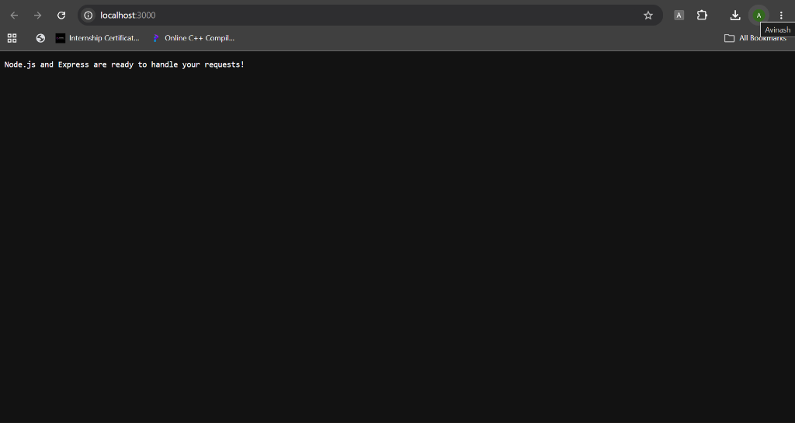
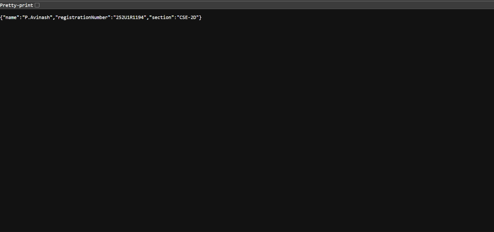
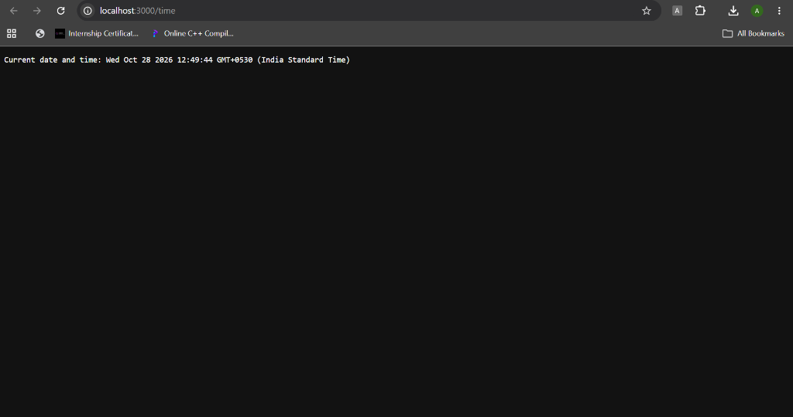
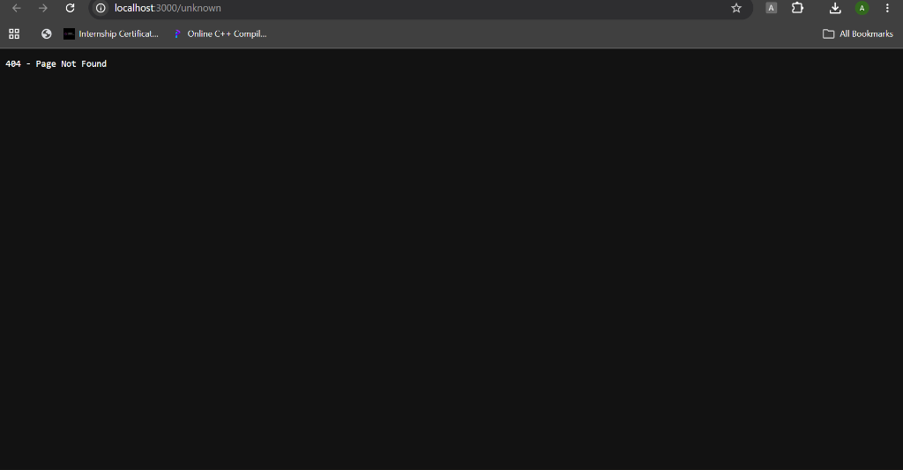

# Lab 1: Node.js and Express Server

**Name:** P.Avinash  
**Registration number:** 252U1R1194  
**Section:** CSE-2D

[](https://render.com/deploy?repo=https://github.com/avinashpodugu1-rgb/P_Avinash_Backend_Lab)

## Architecture

The project separates the server startup, Express app configuration, and route definitions:

```text
lab-01/
├── server.js                  # Starts the Express server
├── http-server.js             # Task 3: built-in Node.js HTTP server
├── screenshots/               # Output verification screenshots
│   ├── home-route.png         # GET / (Home route)
│   ├── about-route.png        # GET /about (About JSON route)
│   ├── time-route.png         # GET /time (Date and time route)
│   └── 404-error.png          # GET /unknown (404 Page Not Found)
├── src/
│   ├── app.js                  # App configuration and 404 fallback
│   └── routes/
│       └── mainRoutes.js       # GET route handlers
├── package.json
└── README.md
```

**Request flow:** Browser/client → `server.js` → `src/app.js` → `src/routes/mainRoutes.js` → response.  
Unknown paths continue to the 404 fallback in `src/app.js`.

## How to run

Use Node.js and npm from this folder:

```bash
npm install
npm start
```

Then open `http://localhost:3000`. To run the plain HTTP server instead, stop the Express server and run:

```bash
npm run plain
```

Both servers use port `3000` by default. Set the `PORT` environment variable to use a different port.

## Live Deployment (Render)

The application is deployed live on Render:

- **Base URL (Home):** [https://p-avinash-backend-lab.onrender.com/](https://p-avinash-backend-lab.onrender.com/)
- **About Route:** [https://p-avinash-backend-lab.onrender.com/about](https://p-avinash-backend-lab.onrender.com/about)
- **Current Date & Time:** [https://p-avinash-backend-lab.onrender.com/time](https://p-avinash-backend-lab.onrender.com/time)
- **404 Error Found:** [https://p-avinash-backend-lab.onrender.com/unknown](https://p-avinash-backend-lab.onrender.com/unknown)

## Express routes and expected results

| Method | Path | Status | Output | Live Render URL | Screenshot |
|---|---|---:|---|---|---|
| GET | `/` | 200 | `Node.js and Express are ready to handle your requests!` | [Live Home](https://p-avinash-backend-lab.onrender.com/) | [Home Screenshot](screenshots/home-route.png) |
| GET | `/about` | 200 | JSON containing name, registration number, and section | [Live About](https://p-avinash-backend-lab.onrender.com/about) | [About Screenshot](screenshots/about-route.png) |
| GET | `/time` | 200 | Current date and time | [Live Time](https://p-avinash-backend-lab.onrender.com/time) | [Time Screenshot](screenshots/time-route.png) |
| GET | Any unknown path, e.g. `/unknown` | 404 | `404 - Page Not Found` | [Live 404](https://p-avinash-backend-lab.onrender.com/unknown) | [404 Screenshot](screenshots/404-error.png) |

### Route Outputs and Screenshots

#### 1. Home Route (`GET /`)
- **Local URL:** `http://localhost:3000/`
- **Live Render URL:** [https://p-avinash-backend-lab.onrender.com/](https://p-avinash-backend-lab.onrender.com/)
- **Output:** `Node.js and Express are ready to handle your requests!`



#### 2. About Route (`GET /about`)
- **Local URL:** `http://localhost:3000/about`
- **Live Render URL:** [https://p-avinash-backend-lab.onrender.com/about](https://p-avinash-backend-lab.onrender.com/about)
- **Response JSON:**

```json
{
  "name": "P.Avinash",
  "registrationNumber": "252U1R1194",
  "section": "CSE-2D"
}
```



#### 3. Date and Time Route (`GET /time`)
- **Local URL:** `http://localhost:3000/time`
- **Live Render URL:** [https://p-avinash-backend-lab.onrender.com/time](https://p-avinash-backend-lab.onrender.com/time)
- **Output:** `Current date and time: <current_timestamp>`



#### 4. 404 Page Not Found (`GET /unknown`)
- **Local URL:** `http://localhost:3000/unknown`
- **Live Render URL:** [https://p-avinash-backend-lab.onrender.com/unknown](https://p-avinash-backend-lab.onrender.com/unknown)
- **Output:** `404 - Page Not Found`



## Built-in HTTP server (Task 3)

`http-server.js` uses Node's built-in `http` module. `GET /` returns `Hello` with status `200`; other paths return `404 - Page Not Found` with status `404`.

## Important concepts

- **`package.json`:** project metadata, dependency list, and npm commands.
- **`node_modules`:** downloaded dependencies created by `npm install`; it does not need to be submitted.
- **`app.listen()`:** starts the Express app listening for requests on a port.
- **Request and response:** `req` contains incoming request details; `res` is used to send status codes, headers, and response data.
- **404 handler:** place it after valid routes so that it only handles requests that do not match another route.

## Problems faced and solutions

1. **Keeping the code organized:** moved route handlers into `src/routes/mainRoutes.js` and kept server startup in `server.js`.
2. **Handling unknown URLs:** added a final 404 middleware after the route module.
3. **Avoiding port conflicts:** stop one server before starting the other, or configure a different `PORT`.
4. **Returning structured data:** used `res.json()` for `/about` so the client receives valid JSON.
5. **Showing the current time:** created a fresh `Date` object whenever `/time` is requested.

## Testing checklist

- [x] Run `npm install`
- [x] Run `npm start`
- [x] Visit `/`, `/about`, and `/time`
- [x] Visit `/unknown` and confirm status `404`
- [ ] Stop Express, run `npm run plain`, and test `/` and `/unknown`
