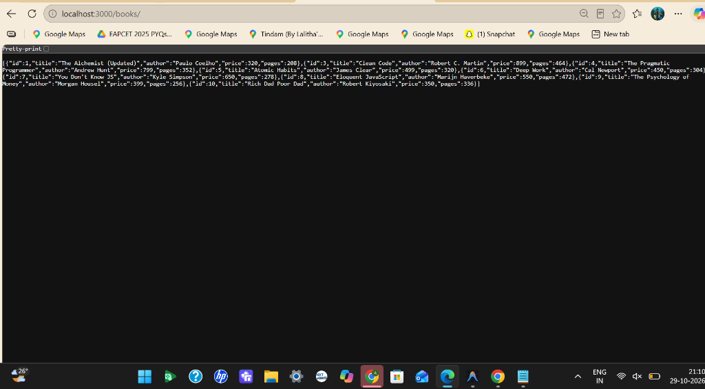
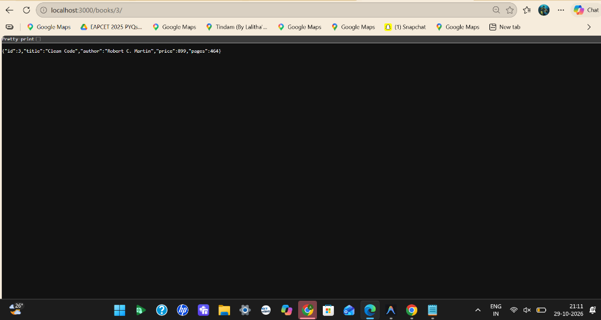
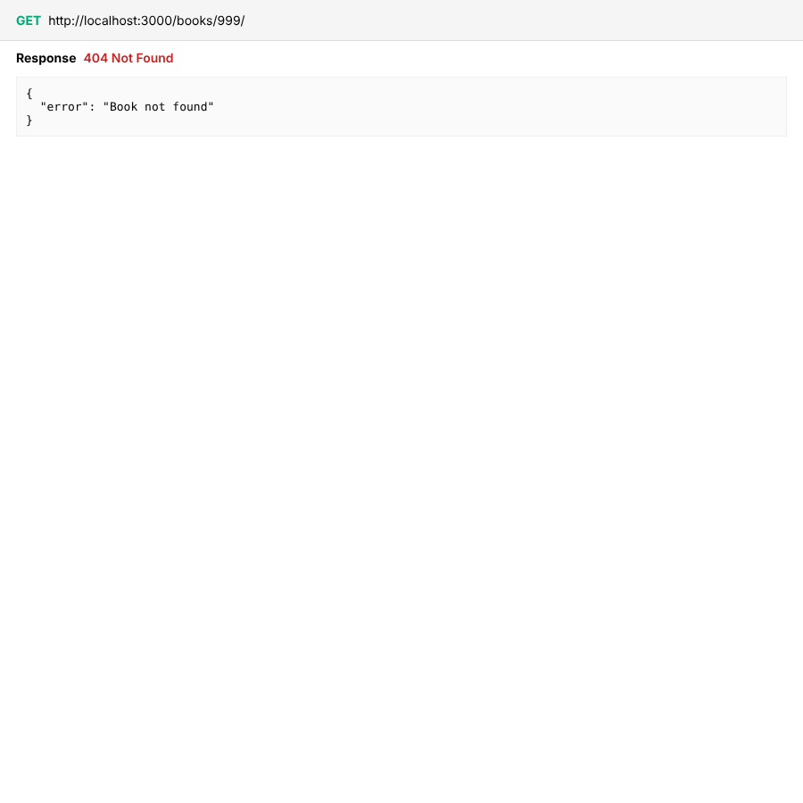
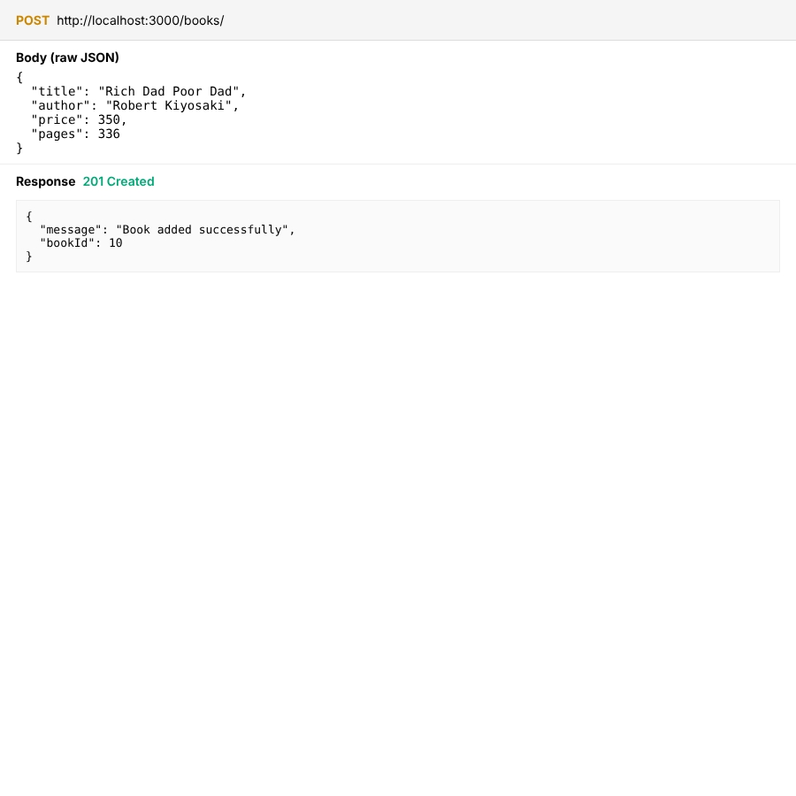
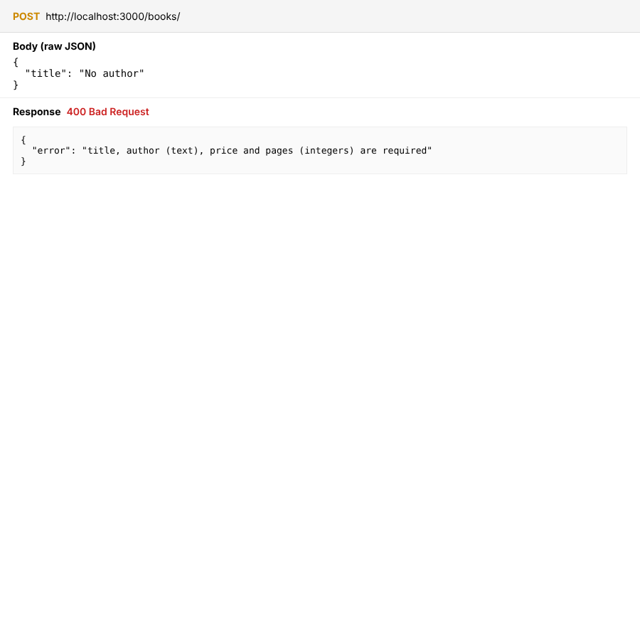
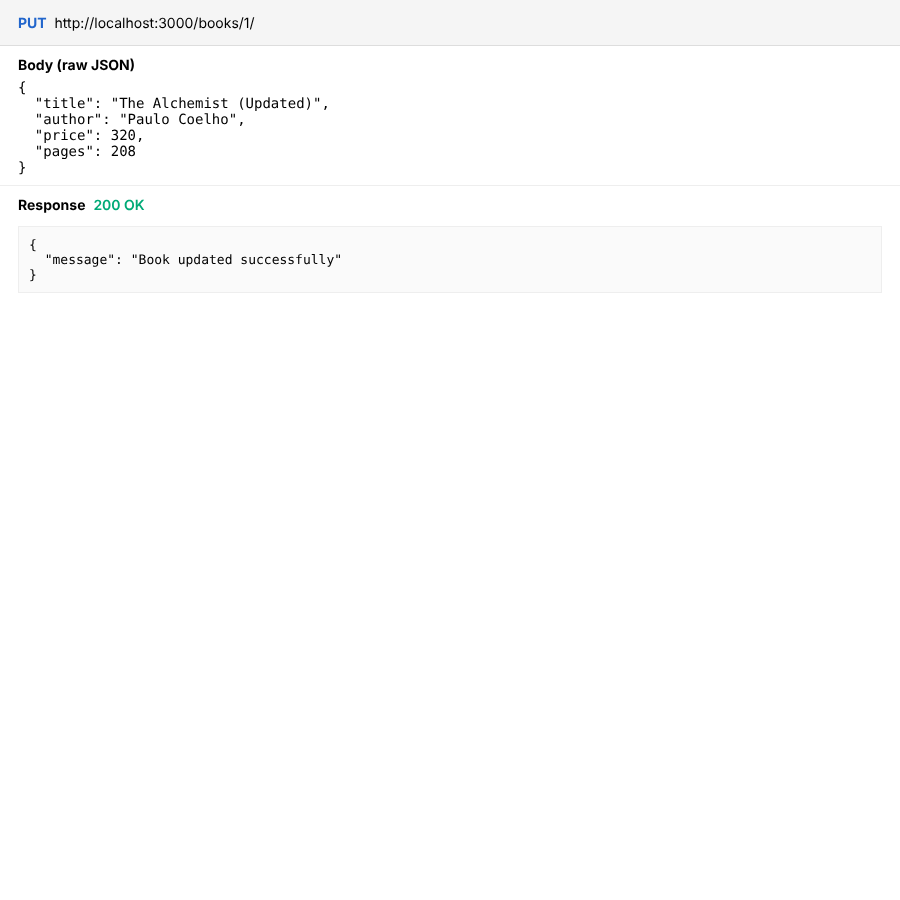
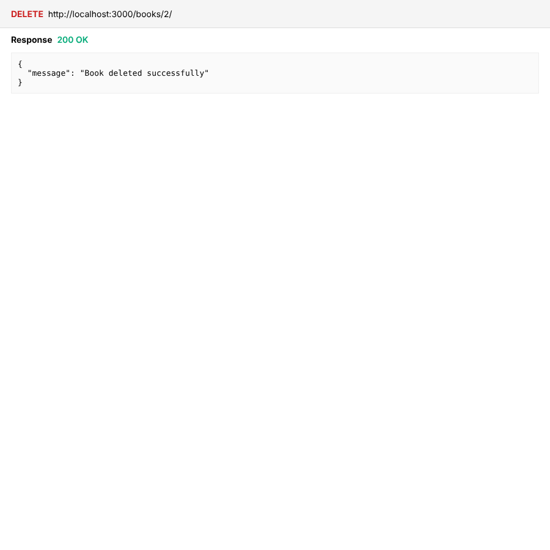
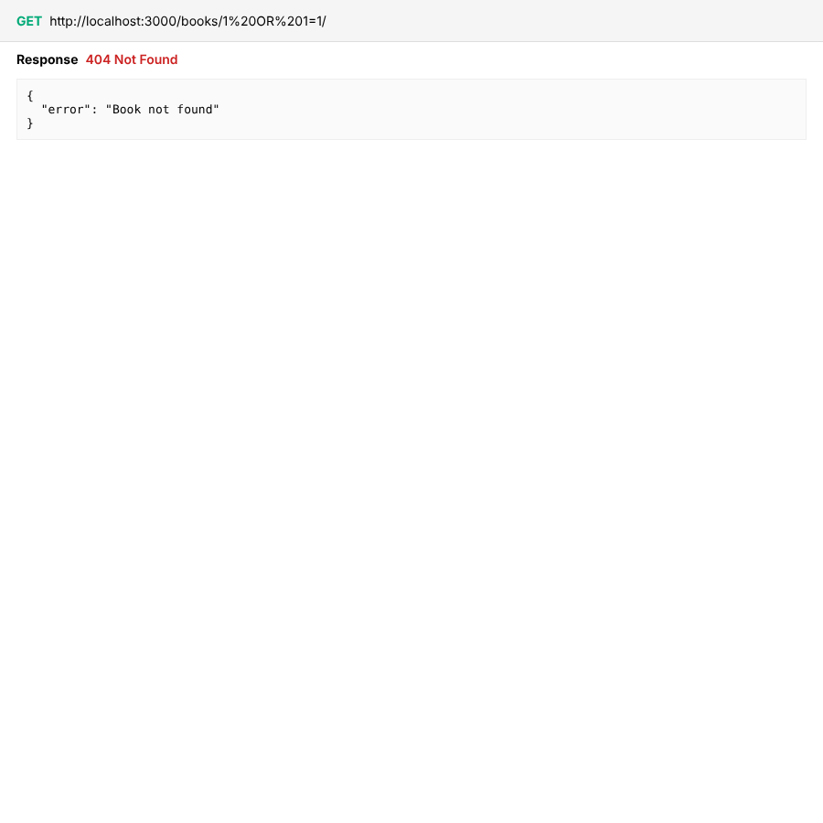
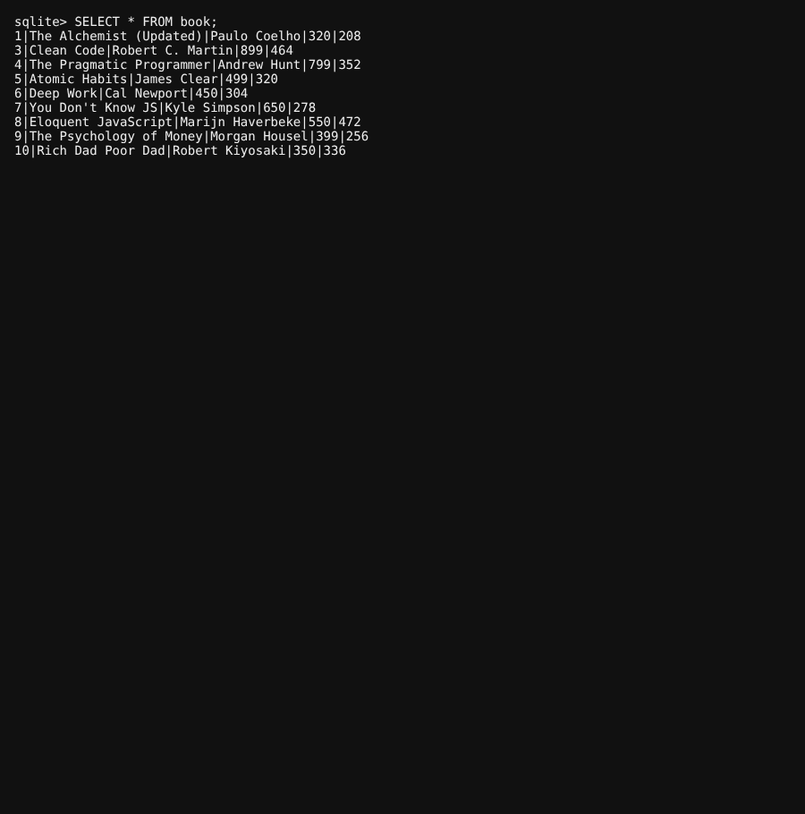

# Lab 2: SQLite database and CRUD routes

**Name:** P. Avinash · **Registration number:** 252U1R1194 · **Section:** CSE-2D  
**Faculty:** Joel Prashanth D · **Course:** Backend Development Fundamentals (Year II Term II)

[](https://render.com/deploy?repo=https://github.com/avinashpodugu1-rgb/P_Avinash_Backend_Lab)

---

## 🌐 Live Render Deployment

The server is deployed live on Render as a cloud web service:

- **Base URL (API Overview):** [https://p-avinash-backend-lab-02.onrender.com/](https://p-avinash-backend-lab-02.onrender.com/)
- **GET All Books:** [https://p-avinash-backend-lab-02.onrender.com/books/](https://p-avinash-backend-lab-02.onrender.com/books/)
- **GET Single Book (ID 3):** [https://p-avinash-backend-lab-02.onrender.com/books/3/](https://p-avinash-backend-lab-02.onrender.com/books/3/)
- **GET Non-Existent Book (404):** [https://p-avinash-backend-lab-02.onrender.com/books/999/](https://p-avinash-backend-lab-02.onrender.com/books/999/)
- **POST Add Book:** `POST https://p-avinash-backend-lab-02.onrender.com/books/`
- **PUT Update Book:** `PUT https://p-avinash-backend-lab-02.onrender.com/books/1/`
- **DELETE Remove Book:** `DELETE https://p-avinash-backend-lab-02.onrender.com/books/2/`

> **Note on Free Instance Cold Starts:** On Render's free tier, the service automatically spins down after 15 minutes of inactivity. The initial request might take 30–50 seconds to wake up the server.

---

## Architecture & Project Structure

The project connects an Express.js web server to an embedded SQLite database using `sqlite` and `sqlite3`, providing full CRUD (Create, Read, Update, Delete) capability over RESTful HTTP endpoints with parameterized SQL queries.

```text
lab-02/
├── index.js                    # Express application & initializeDBAndServer()
├── schema.sql                  # Database table definition & initial 9 seed records
├── initdb.js                   # Database initialization and reset script
├── books.db                    # SQLite database file storing book records
├── package.json                # Project configuration, dependencies & scripts
├── package-lock.json           # Locked dependency tree
├── .gitignore                  # Ignores node_modules/ and .env
├── README.md                   # Lab documentation, instructions & viva answers
└── screenshots/                # Request, response, and database proof captures
    ├── 01-get-all.png          # GET /books/ (200 OK - all books)
    ├── 02-get-one.png          # GET /books/:bookId/ (200 OK - single book)
    ├── 03-get-one-404.png      # GET /books/:bookId/ (404 Not Found)
    ├── 04-post-add.png         # POST /books/ (201 Created)
    ├── 05-post-invalid-400.png # POST /books/ (400 Bad Request - validation error)
    ├── 06-put-update.png       # PUT /books/:bookId/ (200 OK - updated record)
    ├── 07-delete.png           # DELETE /books/:bookId/ (200 OK - deleted record)
    ├── 08-sql-injection-safe.png # SQL injection attempt handled safely (404 Not Found)
    └── 09-database-after-changes.png # SQLite CLI view verifying persistent DB updates
```

---

## How to Run

### 1. Prerequisites
- **Node.js**: v18+ (tested on Node v24)
- **npm**: v9+

### 2. Installation
Install project dependencies (`express`, `sqlite`, `sqlite3`, `nodemon`):
```bash
npm install
```

### 3. Initialize or Reset Database
Rebuild and seed the SQLite database `books.db` from `schema.sql`:
```bash
npm run initdb
```

### 4. Start Server
Run the server with **nodemon** (automatically restarts on file changes):
```bash
npm run dev
```

Or run with standard Node.js:
```bash
npm start
```

### 5. Environment Variables
- `PORT` (Optional): Port number for the HTTP server (default is `3000`, dynamically provided by cloud hosts like Render). No secrets or credentials required.

---

## Database Schema & Seed Data

The database `books.db` contains a table named `book` defined as:

```sql
CREATE TABLE IF NOT EXISTS book (
  id INTEGER PRIMARY KEY AUTOINCREMENT,
  title TEXT NOT NULL,
  author TEXT NOT NULL,
  price INTEGER,
  pages INTEGER
);
```

The database is initially seeded with 9 book rows:
1. *The Alchemist* by Paulo Coelho (₹299, 208 pages)
2. *Wings of Fire* by A. P. J. Abdul Kalam (₹250, 180 pages)
3. *Clean Code* by Robert C. Martin (₹899, 464 pages)
4. *The Pragmatic Programmer* by Andrew Hunt (₹799, 352 pages)
5. *Atomic Habits* by James Clear (₹499, 320 pages)
6. *Deep Work* by Cal Newport (₹450, 304 pages)
7. *You Don't Know JS* by Kyle Simpson (₹650, 278 pages)
8. *Eloquent JavaScript* by Marijn Haverbeke (₹550, 472 pages)
9. *The Psychology of Money* by Morgan Housel (₹399, 256 pages)

---

## Endpoints

| Method | Path | Status Codes | Description | Live Render Link |
|---|---|---|---|---|
| GET | `/` | 200 | Welcome overview and list of all available API endpoints | [Visit API Overview](https://p-avinash-backend-lab-02.onrender.com/) |
| GET | `/books/` | 200, 500 | Retrieve all books ordered by ID | [Visit /books/](https://p-avinash-backend-lab-02.onrender.com/books/) |
| GET | `/books/:bookId/` | 200, 404, 500 | Retrieve a specific book by its ID | [Visit /books/3/](https://p-avinash-backend-lab-02.onrender.com/books/3/) |
| POST | `/books/` | 201, 400, 500 | Add a new book (requires title, author, price, pages) | `POST /books/` |
| PUT | `/books/:bookId/` | 200, 400, 404, 500 | Update all details of an existing book | `PUT /books/:bookId/` |
| DELETE | `/books/:bookId/` | 200, 404, 500 | Remove a book from the database by its ID | `DELETE /books/:bookId/` |

> **Note:** All queries taking user input strictly use `?` placeholders for parameterized execution to prevent SQL injection.

---

## Route Walkthrough & Verification Screenshots

### 1. GET `/books/` — Retrieve All Books
- **URL:** `http://localhost:3000/books/`
- **Method:** `GET`
- **Status:** `200 OK`
- **Live URL:** [https://p-avinash-backend-lab-02.onrender.com/books/](https://p-avinash-backend-lab-02.onrender.com/books/)
- **Output:** Returns JSON array containing all books stored in SQLite.



---

### 2. GET `/books/:bookId/` — Retrieve a Single Book by ID
- **URL:** `http://localhost:3000/books/3/`
- **Method:** `GET`
- **Status:** `200 OK`
- **Live URL:** [https://p-avinash-backend-lab-02.onrender.com/books/3/](https://p-avinash-backend-lab-02.onrender.com/books/3/)
- **Output:** Returns book record with ID 3 (*Clean Code*).



---

### 3. GET `/books/:bookId/` — Non-Existent Book ID (404)
- **URL:** `http://localhost:3000/books/999/`
- **Method:** `GET`
- **Status:** `404 Not Found`
- **Live URL:** [https://p-avinash-backend-lab-02.onrender.com/books/999/](https://p-avinash-backend-lab-02.onrender.com/books/999/)
- **Output:** `{"error": "Book not found"}`



---

### 4. POST `/books/` — Add a New Book
- **URL:** `http://localhost:3000/books/`
- **Method:** `POST`
- **Headers:** `Content-Type: application/json`
- **Request Body:**
```json
{
  "title": "Rich Dad Poor Dad",
  "author": "Robert Kiyosaki",
  "price": 350,
  "pages": 336
}
```
- **Status:** `201 Created`
- **Output:** `{"message": "Book added successfully", "bookId": 10}`



---

### 5. POST `/books/` — Request Validation Error (400)
- **URL:** `http://localhost:3000/books/`
- **Method:** `POST`
- **Headers:** `Content-Type: application/json`
- **Request Body:** `{"title": "Rich Dad Poor Dad"}` (missing author, price, pages)
- **Status:** `400 Bad Request`
- **Output:** `{"error": "title, author (text), price and pages (integers) are required"}`



---

### 6. PUT `/books/:bookId/` — Update an Existing Book
- **URL:** `http://localhost:3000/books/1/`
- **Method:** `PUT`
- **Headers:** `Content-Type: application/json`
- **Request Body:**
```json
{
  "title": "The Alchemist (Updated)",
  "author": "Paulo Coelho",
  "price": 320,
  "pages": 208
}
```
- **Status:** `200 OK`
- **Output:** `{"message": "Book updated successfully"}`



---

### 7. DELETE `/books/:bookId/` — Delete a Book
- **URL:** `http://localhost:3000/books/2/`
- **Method:** `DELETE`
- **Status:** `200 OK`
- **Output:** `{"message": "Book deleted successfully"}`



---

### 8. SQL Injection Prevention Verification
- **URL:** `http://localhost:3000/books/1%20OR%201=1/`
- **Method:** `GET`
- **Status:** `404 Not Found`
- **Explanation:** Because `?` parameterized queries are used (`SELECT * FROM book WHERE id = ?`), the input `"1 OR 1=1"` is treated as a literal string value for `id`, rather than executable SQL logic. The database searches for a book with that literal string ID, finds nothing, and returns 404 safely.



---

### 9. SQLite Database Verification (Post Changes)
- **Command:** `sqlite3 books.db "SELECT * FROM book;"`
- **Observation:**
  - Book `id=1` is updated to title `"The Alchemist (Updated)"` and price `320`.
  - Book `id=2` is deleted.
  - Book `id=10` (*Rich Dad Poor Dad*) is added.



---

## Viva Questions & Answers

### 1. Why await the database call?
> **Answer:** Database read and write operations involve disk I/O and are asynchronous in Node.js, returning JavaScript `Promise` objects. If we do not `await` the call (or chain `.then()`), the JavaScript runtime immediately executes the next line before the query completes. As a result, the route handler would send an empty or pending Promise object to the client instead of the actual data, or send a response before database errors could be caught in `try...catch`.

### 2. What is SQL injection and how do placeholders prevent it?
> **Answer:** SQL injection occurs when untrusted user input is directly concatenated or interpolated into a SQL query string (e.g., `'SELECT * FROM book WHERE id = ' + req.params.bookId`). An attacker could supply malicious SQL fragments such as `1 OR 1=1` or `1; DROP TABLE book;` to alter query logic or destroy data.  
> 
> Placeholders (the `?` syntax in parameterized queries) prevent this by enforcing a separation between SQL code and data:
> 1. The database driver compiles the SQL statement structure first.
> 2. The user input values are bound separately as literal data values.
> 3. Even if the input contains SQL keywords, quotes, or operators, SQLite never treats them as executable commands.

### 3. When is PUT used instead of POST?
> **Answer:** 
> - **POST** is used to create a new subordinate resource. The client sends data to a collection endpoint (`/books/`), and the server determines the new resource's identity/ID (e.g. `id: 10`). POST is generally non-idempotent (sending the same request multiple times creates multiple duplicate resources).
> - **PUT** is used to replace or update an existing resource at a specific, known resource URI (`/books/:bookId/`). PUT is idempotent (sending the same update request multiple times results in the identical database state).

---

## Notes: Problems Faced & Solutions

1. **Server starting before database connection:**  
   *Problem:* If incoming HTTP requests hit endpoints before the database connection opens, queries fail with `TypeError: Cannot read properties of null (reading 'all')`.  
   *Solution:* Implemented `initializeDBAndServer()` as an `async` function. The database is opened first using `await open(...)`, and `app.listen(PORT, ...)` is called only after the database connection is verified.

2. **Accurate HTTP Status Codes on Missing Resources:**  
   *Problem:* When `PUT` or `DELETE` receives a non-existent `bookId`, SQLite does not throw an error; it simply modifies 0 rows.  
   *Solution:* Inspected `result.changes`. If `result.changes === 0`, returned status `404 Not Found` with `{ error: 'Book not found' }`.

3. **Data Type and Payload Validation:**  
   *Problem:* Inserting invalid or missing fields could result in corrupt records or database-level constraint exceptions.  
   *Solution:* Implemented `isValidBook()` helper to check that `title` and `author` are non-empty strings and `price` and `pages` are integers, returning status `400 Bad Request` on invalid payloads.

---

## Testing Checklist

- [x] Dependencies installed (`express`, `sqlite`, `sqlite3`, `nodemon`)
- [x] Database table `book` created and seeded with 9 rows via `schema.sql`
- [x] Server runs with nodemon (`npm run dev`) and standard node (`npm start`)
- [x] `initializeDBAndServer()` opens database before `app.listen()`
- [x] `GET /books/` returns all books (Status 200)
- [x] `GET /books/:bookId/` returns single book (Status 200)
- [x] `GET /books/:bookId/` with non-existent ID returns 404
- [x] `POST /books/` adds book and returns assigned `bookId` (Status 201)
- [x] `POST /books/` with invalid body returns validation error (Status 400)
- [x] `PUT /books/:bookId/` updates book (Status 200)
- [x] `DELETE /books/:bookId/` removes book (Status 200)
- [x] Parameterized `?` placeholders prevent SQL injection
- [x] `books.db` verified via SQLite query showing persistent updates
- [x] Screenshots captured and embedded in `screenshots/`
- [x] `.gitignore` configured to ignore `node_modules/` and `.env`
- [x] Configured for automated Render Cloud deployment via `render.yaml
